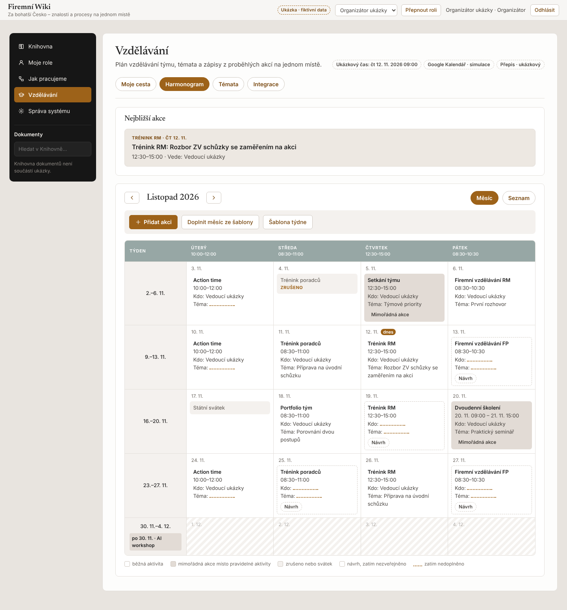
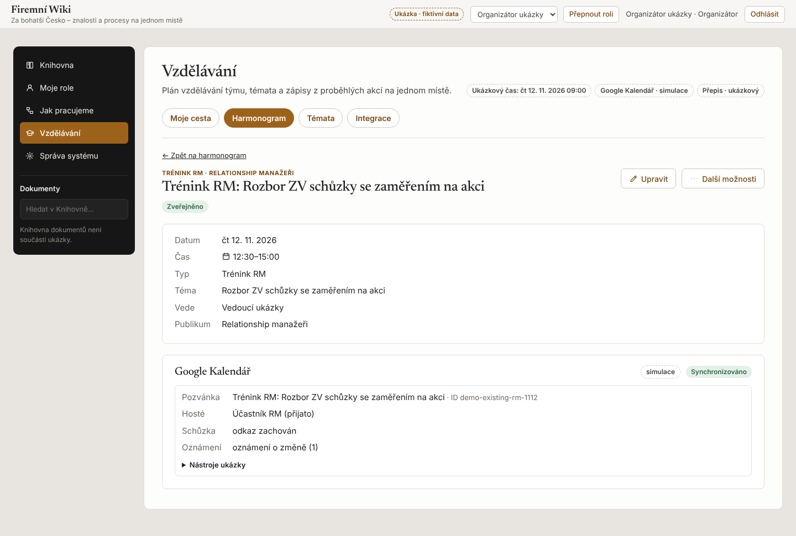
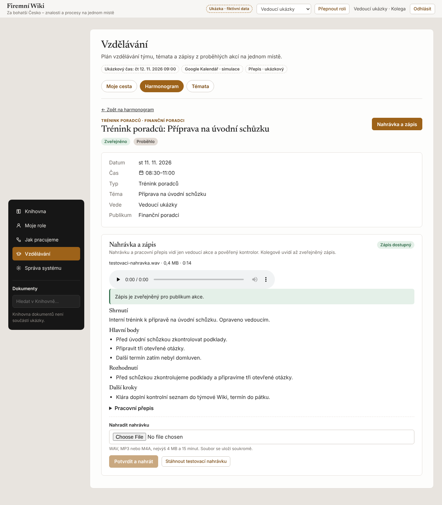
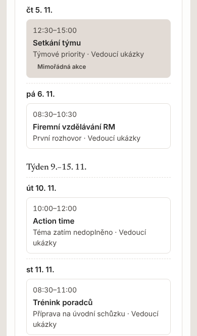

# Firemní Wiki · modul Vzdělávání (demo)

Funkční ukázka modulu Vzdělávání pro firemní Wiki Za bohatší Česko. Nahrazuje tři nepropojené nástroje
(Notion, Numbers a ruční úpravy v Google Kalendáři) jedním místem: témata se zájmem, měsíční harmonogram
ze šablony, synchronizace schválených změn do Kalendáře a zápisy z nahrávek u konkrétních akcí.

Demo pracuje **výhradně s fiktivními daty**. Google Kalendář běží jako **simulace** a přepis jako
**ukázkový režim** nad přiloženou syntetickou nahrávkou. Oba stavy jsou v aplikaci viditelně označené.

Vedle simulace je připravený **testovací režim Google Kalendáře** (skutečné Google Calendar API, šifrované
tokeny, povolené kalendáře a příjemci). Je ověřený jen proti napodobenému HTTP, **ne proti Googlu**.
Nastavení a postup živého testu jsou v [docs/google-kalendar.md](docs/google-kalendar.md).

Stejně je připravené **přihlášení Google identitou** jako druhý režim vedle fiktivních rolí (ověření ID
tokenu, vazba účtu na stabilní `sub`, role dál z databáze). Také **neověřeno proti Googlu**, viz
[docs/google-prihlaseni.md](docs/google-prihlaseni.md).

| | |
|---|---|
|  |  |
|  |  |

## Spuštění

Potřebujete Node.js 22.

```bash
npm ci
npm run dev          # http://localhost:3000, lokální databáze PGlite v ./.data
```

Lokálně není přístupová brána. Na úvodní obrazovce vyberete fiktivní roli, kterou lze kdykoli přepnout
v horní liště. Data přežijí restart. Výchozí stav obnovíte příkazem `npm run db:reset` (při vypnutém
serveru) nebo tlačítkem *Vzdělávání → Integrace → Obnovit ukázková data*.

| Příkaz | Co dělá |
|---|---|
| `npm run lint` · `npm run typecheck` | ESLint a TypeScript |
| `npm test` | 114 testů: správa uživatelů, přístupy, plán a revize, Kalendář, přihlášení Google, témata, nahrávky, čas a session |
| `npm run build` | Produkční build (vyžaduje `SESSION_SECRET` a `DEMO_ACCESS_CODE`) |
| `npm run db:migrate` · `npm run db:reset` | Migrace a seed, nebo obnova ukázkových dat |

## Role v ukázce

| Role | Co ukazuje |
|---|---|
| Správce ZBC ukázky | Přiděluje role a skupiny, zve a schvaluje účty Google (Správa systému). Plánuje jako organizátor. |
| Organizátor ukázky | Plánuje, zveřejňuje, spravuje vazbu na Kalendář. K audiu nemá automatický přístup. |
| Vedoucí ukázky | Vede akce, nahrává záznam, kontroluje a zveřejňuje zápis. |
| Účastník FP | Kolega ze skupiny finančních poradců. Čte plán a zveřejněné zápisy své skupiny. |
| Účastník RM | Kolega mimo publikum tréninku poradců. Přístup k cizí akci je zamítnut i přímým odkazem. |

Demo běží v referenčním čase ze seedu (čt 12. 11. 2026 9:00), aby scénář seděl na listopadová data.
`DEMO_CLOCK=real` přepne na skutečný čas.

## Proměnné prostředí

Vzor je v `.env.example`. Hodnoty tajemství patří do správce tajemství hostingu, nikdy do repozitáře.

| Proměnná | Povinná | Význam |
|---|---|---|
| `DATABASE_URL` | na hostingu | Postgres (Neon). Bez ní běží lokální PGlite. |
| `SESSION_SECRET` | na hostingu | Klíč pro podpis session, min. 32 znaků. |
| `DEMO_ACCESS_CODE` | na hostingu | Přístupový kód do dema, min. 12 znaků. |
| `APP_URL` | ne | Adresa Wiki pro odkaz v pozvánce. |
| `DEMO_CLOCK` | ne | `real` = skutečný čas místo ukázkového. |
| `SIM_LATENCY_MS` | ne | Zpoždění simulací v ms (výchozí 1200). |
| `CALENDAR_MODE` | ne | `google-test` zapne testovací režim Google Kalendáře. Jinak simulace. |
| `CALENDAR_ATTENDEES` | ne | `audience` zve v režimu Googlu skutečné publikum akce (aktivní účty skupiny). Jinak jen `GOOGLE_ALLOWED_ATTENDEES`. |
| `GOOGLE_*`, `TOKEN_ENCRYPTION_KEY` | v režimu `google-test` | Viz [docs/google-kalendar.md](docs/google-kalendar.md). |
| `LOGIN_MODE` | ne | `google-test` přidá přihlášení účtem Google. Jinak jen fiktivní role. |
| `GOOGLE_LOGIN_ACCOUNTS` | ne | Zaváděcí seznam účtů, ostatní zve a schvaluje Správa systému, viz [docs/google-prihlaseni.md](docs/google-prihlaseni.md). |

## Architektura

Next.js 16 (App Router, server actions), TypeScript, Postgres přes Drizzle ORM. Lokálně a v testech
PGlite, na hostingu Neon. Migrace jsou čisté SQL v `src/server/db/migrations.ts` a aplikují se pod
zámkem při prvním připojení, prázdnou databázi naplní fiktivní seed z `demo/seed.json`.

```text
src/
├── app/                      # routy: vstup, Domov, Vzdělávání (harmonogram, témata, detail, integrace), API nahrávek
├── components/               # shell Wiki (horní lišta, levé menu) a obecné prvky (dialog, formulář akce serveru)
├── features/vzdelavani/      # serverové akce a komponenty modulu
├── lib/                      # sdílené typy, popisky a práce s časem v Europe/Prague
└── server/
    ├── policy.ts             # jediné místo pravidel přístupu
    ├── auth/                 # podepsaná session, přístupová brána, fiktivní role
    ├── domain/               # šablona měsíce, svátky, doporučení témat, snímek zveřejněné akce
    ├── services/             # akce, témata, nahrávky a zápisy, detail
    ├── calendar/             # rozhraní poskytovatele Kalendáře, simulace, adaptér Google, synchronizace
    ├── recordings/           # ověření audia, rozhraní přepisu a ukázkový poskytovatel
    └── db/                   # schéma, migrace, připojení
tests/                        # cílené testy podle scénářů v předání
docs/predani.md               # ověření, stav integrací a podmínky nasazení
```

Hlavní rozhodnutí:

- **Návrh a zveřejnění jsou oddělené.** Organizátor může uložit rozpracovanou změnu. Kolegové i Kalendář
  vidí jen poslední zveřejněný snímek akce. Každá změna má revizi, souběžná úprava starší revize neprojde.
- **Kalendář dostává vždy nejnovější zveřejněnou revizi.** Synchronizace běží pod zámkem na akci,
  zapisuje jen spravovaná pole (název, čas, stav, odkaz do Wiki) a hosty, RSVP i odkaz na schůzku nemění.
  Vytvoření pozvánky má stabilní klíč, opakování nevyrobí duplikát. Ruční změnu v Kalendáři ukáže
  organizátorovi a přepíše ji jen s jeho souhlasem.
- **Importovaná akce bez vazby sama pozvánku nezaloží.** Organizátor ji spáruje s existující pozvánkou,
  nebo výslovně založí novou. Akce založené ve Wiki pozvánku dostanou při zveřejnění.
- **Šablona doplňuje jen prázdné sloty.** Klíč návrhu je slot + původní datum. Ruční úpravy i přesuny
  zůstanou, smazaný návrh se nevrátí. Svátky ČR vzniknou jako viditelný záznam bez pozvánky.
- **Témata jdou do návrhu měsíce rovnou.** Budoucím termínům firemního vzdělávání generování předvyplní
  doporučené téma jejich publika: jen téma se zájemci, které ještě nemá termín, každé nejvýš jednou.
  Vzniká jako návrh, organizátor ho před zveřejněním změní nebo smaže.
- **Nahrávka patří k ID akce, ne k odhadu z obsahu.** Rozpoznaný typ obsahu jen doporučí šablonu zápisu
  a upozorní na nesoulad.

## Bezpečnost

- Přístupy ověřuje server u každého výpisu, detailu, uploadu, stažení, opakování i zveřejnění
  (`src/server/policy.ts`). Neviditelná a neexistující akce vrací stejnou odpověď.
- Audio a pracovní přepis vidí jen vedoucí akce a pověřený kontrolor. Organizátor k nim automaticky přístup
  nemá. Zveřejněný zápis vidí publikum akce.
- Soubory se ověřují podle obsahu (signatura a struktura WAV/MP3/M4A, délka), limit 4 MB a 15 minut.
  Ukládají se soukromě pod generovaným klíčem a vydávají se jen autorizovanou serverovou cestou.
  Nahrazená nahrávka se smaže.
- Výstup přepisu a modelu je nedůvěryhodný: validuje se schématem a vykresluje se jako prostý text.
- Session je podepsaná HttpOnly cookie, role se načítají z databáze při každém požadavku. Server actions
  mají kontrolu původu, vstupy se validují (Zod), dotazy jsou parametrizované.
- Přihlášení účtem Google (volitelný testovací režim) ověřuje ID token na serveru a váže účet na stabilní
  `sub`. Odebrání účtu ze seznamu ukončí i běžící session. Přihlášený účtem Google nepřepíná role.
- Na hostingu je povinná přístupová brána s omezením počtu pokusů. Odpovědi mají CSP s nonce,
  `frame-ancestors 'none'`, `nosniff` a `noindex`.
- Audit zaznamenává kdo, co a kdy bez obsahu dat. Provozní log obsahuje jen kódy chyb.
- Ochrana repozitáře: `.gitignore` pro tajemství a podklady, `.claude/settings.json`, pre-push hook
  (`git config --local core.hooksPath .githooks`) a CI s kontrolou citlivých cest.

## Nasazení

Hosting je Vercel + Neon (region EU). Nastavte `DATABASE_URL`, `SESSION_SECRET` a `DEMO_ACCESS_CODE`
v nastavení projektu. Schéma a seed se vytvoří při prvním požadavku. Produkční nasazení a sdílení
odkazu řídí vlastník repozitáře. Podmínky pro provoz s reálnými daty jsou v `docs/predani.md`.
