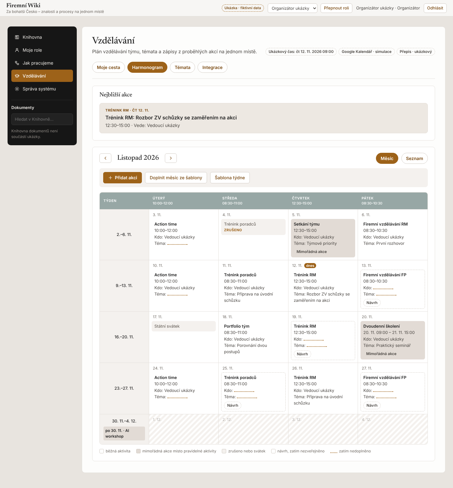
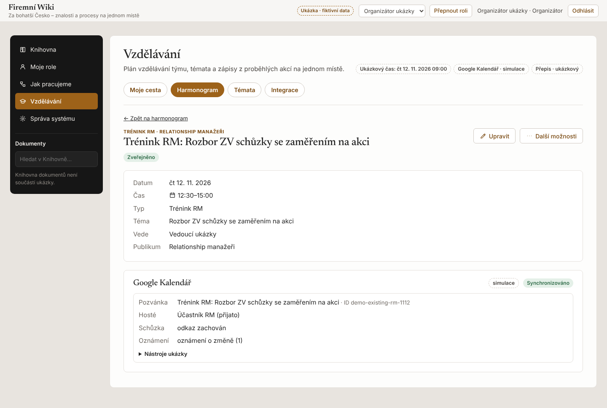
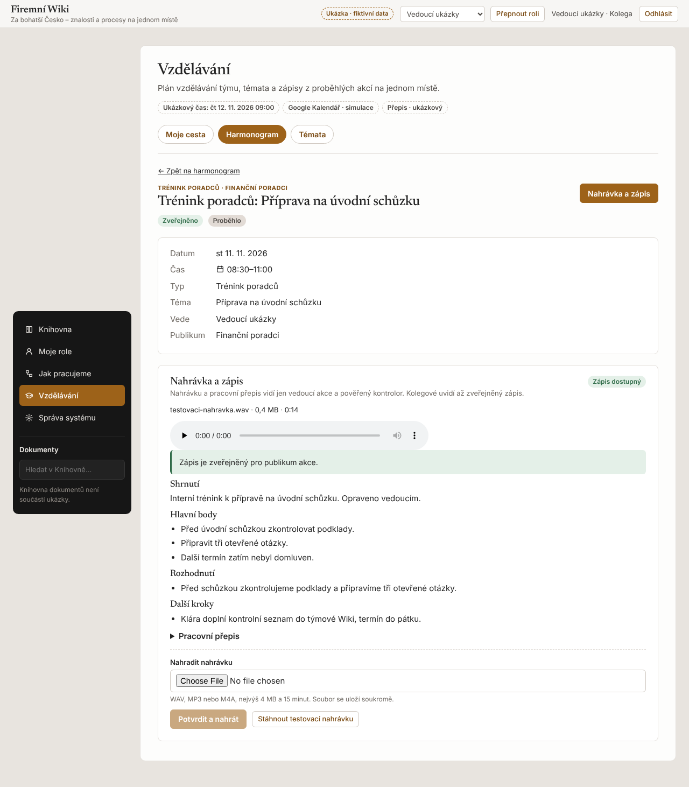
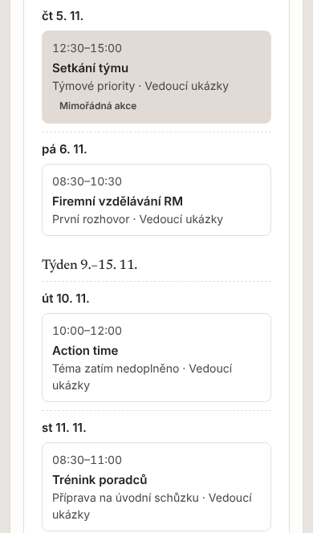

# Firemní Wiki · modul Vzdělávání (demo)

Funkční ukázka modulu Vzdělávání pro firemní Wiki Za bohatší Česko. Nahrazuje tři nepropojené nástroje
(Notion, Numbers a ruční úpravy v Google Kalendáři) jedním místem: témata se zájmem, měsíční harmonogram
ze šablony, synchronizace schválených změn do Kalendáře a zápisy z nahrávek u konkrétních akcí.

Demo pracuje **výhradně s fiktivními daty**. Google Kalendář běží jako **simulace** a přepis jako
**ukázkový režim** nad přiloženou syntetickou nahrávkou. Oba stavy jsou v aplikaci viditelně označené.

Vedle simulace je připravený **testovací režim Google Kalendáře** (skutečné Google Calendar API, šifrované
tokeny, povolené kalendáře a příjemci). Je ověřený jen proti napodobenému HTTP, **ne proti Googlu**.
Nastavení a postup živého testu jsou v [docs/google-kalendar.md](docs/google-kalendar.md).

Stejně je připravené **přihlášení Google identitou** jako druhý režim vedle fiktivních rolí (ověření ID
tokenu, vazba účtu na stabilní `sub`, role dál z databáze). Také **neověřeno proti Googlu**, viz
[docs/google-prihlaseni.md](docs/google-prihlaseni.md).

Stejný kód běží i jako **ostrá Wiki pro firmu** (`WIKI_MODE=production`): vstup jen účtem Google,
vlastní prázdná databáze, skutečný čas a Google Kalendář. Rozdělení Production a Preview, proměnné
a kroky nasazení jsou v [docs/nasazeni.md](docs/nasazeni.md).

| | |
|---|---|
|  |  |
|  |  |

## Spuštění

Potřebujete Node.js 22.

```bash
npm ci
npm run dev          # http://localhost:3000, lokální databáze PGlite v ./.data
```

Lokálně není přístupová brána. Na úvodní obrazovce vyberete fiktivní roli, kterou lze kdykoli přepnout
v horní liště. Data přežijí restart. Výchozí stav obnovíte příkazem `npm run db:reset` (při vypnutém
serveru) nebo tlačítkem *Vzdělávání → Integrace → Obnovit ukázková data*.

| Příkaz | Co dělá |
|---|---|
| `npm run lint` · `npm run typecheck` | ESLint a TypeScript |
| `npm test` | Testy (vitest): správa uživatelů, přístupy, plán a revize, Kalendář, přihlášení Google, témata, nahrávky, čas a session |
| `npm run e2e` | Playwright nad produkčním buildem: 4 role, všechny stránky a okna, klávesnice, axe, ostrá Wiki s falešnými hodnotami Google. Desktop Windows (1280, 1920), macOS (1440×900, 1512×982, Retina, user agent Safari a Chrome) a telefony (390, 360, 320). Vykresluje Chromium, skutečné Safari viz [docs/overeni-mac.md](docs/overeni-mac.md). `E2E_SKIP_BUILD=1` přeskočí build. |
| `npm run build` | Produkční build (vyžaduje `SESSION_SECRET` a `DEMO_ACCESS_CODE`) |
| `npm run db:migrate` · `npm run db:reset` | Migrace a seed, nebo obnova ukázkových dat |

## Role v ukázce

| Role | Co ukazuje |
|---|---|
| Správce ZBC ukázky | Plánuje a zveřejňuje akce, přiděluje role a skupiny, zve a schvaluje účty Google (Správa systému). |
| Správce vzdělávání | Druhý správce se stejnými právy. Na preview bývá svázaný s testovacím účtem Google, který propojuje Kalendář. |
| Vedoucí akce | Vede akce, nahrává záznam, kontroluje a zveřejňuje zápis. |
| Účastník – finanční poradce | Kolega ze skupiny finančních poradců. Čte plán a zveřejněné zápisy své skupiny. |
| Účastník – relationship manažer | Kolega mimo publikum tréninku poradců. Přístup k cizí akci je zamítnut i přímým odkazem. |

Role jsou jen dvě: **Správce** (plánuje, zveřejňuje, spravuje účty, Kalendář a u každé akce smí nahrát záznam,
upravit, zveřejnit i stáhnout zápis) a **Člen týmu** (vidí akce a zápisy svých skupin, vede akce, ke kterým je
přiřazený). V databázi zůstávají hodnoty `admin` i `organizer`, obě znamenají Správce.

Demo běží v referenčním čase ze seedu (čt 12. 11. 2026 9:00), aby scénář seděl na listopadová data.
`DEMO_CLOCK=real` přepne na skutečný čas.

## Proměnné prostředí

Vzor je v `.env.example`. Hodnoty tajemství patří do správce tajemství hostingu, nikdy do repozitáře.

| Proměnná | Povinná | Význam |
|---|---|---|
| `DATABASE_URL` | na hostingu | Postgres (Neon). Bez ní běží lokální PGlite. |
| `SESSION_SECRET` | na hostingu | Klíč pro podpis session, min. 32 znaků. |
| `DEMO_ACCESS_CODE` | na hostingu ukázky | Přístupový kód do dema, min. 12 znaků. Zvací odkaz `/vstup?pozvanka=<kód>` ho ověří a uloží cookie brány na 7 dní. Ostrá Wiki ho nepotřebuje. |
| `APP_URL` | ne | Adresa Wiki pro odkaz v pozvánce. |
| `WIKI_MODE` | ne | `production` = ostrá Wiki pro firmu: odmítne fiktivní role, obnovu ukázkových dat a přepínače simulace, běží ve skutečném čase, prázdnou databázi naplní jen pravidelným týdnem a bez přihlášení Googlem a Kalendáře se nespustí. Jinak ukázka. |
| `DEMO_CLOCK` | ne | `real` = skutečný čas místo ukázkového. |
| `SIM_LATENCY_MS` | ne | Zpoždění simulací v ms (výchozí 1200). |
| `CALENDAR_MODE` | ne | `google-test` zapne testovací režim Google Kalendáře. Jinak simulace. |
| `CALENDAR_ATTENDEES` | ne | `audience` zve v režimu Googlu skutečné publikum akce (aktivní účty skupiny). Jinak jen `GOOGLE_ALLOWED_ATTENDEES`, která je pak povinná. |
| `CALENDAR_DELIVERY` | ne | Prázdné nebo `organizer` = pozvánky z kalendáře dedikovaného organizátora s frontou a odpověďmi (RSVP), viz [docs/kalendar-organizator.md](docs/kalendar-organizator.md). `personal` = dočasný starý režim osobních kalendářů. Režimy se vylučují. |
| `GOOGLE_ORGANIZER_EMAIL` | v režimu organizátora | Účet Google organizátora. Kalendář smí propojit jen on (porovnává se ověřený e-mail z ID tokenu Googlu), přihlášení správce se na Kalendář neptá. Bez ní se pozvánky neposílají a Integrace ukáže problém. |
| `CALENDAR_WORKER_TOKEN` | pro plánovač | Tajný token, který GitHub Actions posílá endpointu fronty Kalendáře (`Authorization: Bearer`). Min. 32 znaků. |
| `CRON_SECRET` | pro denní cron | Tajemství, které Vercel posílá svému cronu na stejný endpoint. Min. 32 znaků, doporučeně jiné než `CALENDAR_WORKER_TOKEN`. |
| `GOOGLE_OAUTH_PUBLISHED` | ne | `1`, když je souhlasová obrazovka Googlu zveřejněná. Vypne upozornění na vypršení propojení po 7 dnech (režim Testing). |
| `GOOGLE_*`, `TOKEN_ENCRYPTION_KEY` | v režimu `google-test` | Viz [docs/google-kalendar.md](docs/google-kalendar.md). |
| `LOGIN_MODE` | ne | `google-test` přidá přihlášení účtem Google. Jinak jen fiktivní role. |
| `GOOGLE_LOGIN_ACCOUNTS` | ne | Zaváděcí seznam účtů pro ukázku, ostatní zve a schvaluje Správa systému, viz [docs/google-prihlaseni.md](docs/google-prihlaseni.md). Ostrá Wiki ho ignoruje. |
| `BOOTSTRAP_ADMIN_EMAILS` | ne | Adresy oddělené čárkou, jejichž první přihlášení Googlem založí aktivního správce. Slouží ke spuštění prázdné ostré Wiki. |

## Architektura

Next.js 16 (App Router, server actions), TypeScript, Postgres přes Drizzle ORM. Lokálně a v testech
PGlite, na hostingu Neon. Migrace jsou čisté SQL v `src/server/db/migrations.ts` a aplikují se pod
zámkem při prvním připojení, prázdnou databázi naplní fiktivní seed z `demo/seed.json`.

```text
src/
├── app/                      # routy: vstup, Domov, Vzdělávání (harmonogram, témata, detail, integrace), API nahrávek
├── components/               # shell Wiki (horní lišta, levé menu) a obecné prvky (dialog, formulář akce serveru)
├── features/vzdelavani/      # serverové akce a komponenty modulu
├── lib/                      # sdílené typy, popisky a práce s časem v Europe/Prague
└── server/
    ├── policy.ts             # jediné místo pravidel přístupu
    ├── auth/                 # podepsaná session, přístupová brána, fiktivní role
    ├── domain/               # šablona měsíce, svátky, doporučení témat, snímek zveřejněné akce
    ├── services/             # akce, témata, nahrávky a zápisy, detail
    ├── calendar/             # rozhraní poskytovatele Kalendáře, simulace, adaptér Google, synchronizace
    ├── recordings/           # ověření audia, rozhraní přepisu a ukázkový poskytovatel
    └── db/                   # schéma, migrace, připojení
tests/                        # cílené testy podle scénářů v předání
docs/predani.md               # ověření, stav integrací a podmínky nasazení
```

Hlavní rozhodnutí:

- **Návrh a zveřejnění jsou oddělené.** Správce může uložit rozpracovanou změnu. Kolegové i Kalendář
  vidí jen poslední zveřejněný snímek akce. Každá změna má revizi, souběžná úprava starší revize neprojde.
- **Kalendář dostává vždy nejnovější zveřejněnou revizi.** Synchronizace běží pod zámkem na akci,
  zapisuje jen spravovaná pole (název, čas, stav, odkaz do Wiki) a hosty, RSVP i odkaz na schůzku nemění.
  Vytvoření pozvánky má stabilní klíč, opakování nevyrobí duplikát. Ruční změnu v Kalendáři ukáže
  správci a přepíše ji jen s jeho souhlasem.
- **Každá zveřejněná budoucí akce dostane pozvánku sama.** Akce bez vazby ji získá po otevření Plánu správcem,
  po zveřejnění, hromadném zveřejnění i obnově ukázkových dat. Pozvánku, kterou Wiki založila dřív, pozná
  podle klíče a nezdvojí. Když ve stejném čase leží v Kalendáři cizí nespárovaná pozvánka, akce zůstane
  „bez vazby“ a správce ji spáruje, nebo založí novou. Čekající pozvánky odešle fronta po otevření Plánu.
- **Hromadné zveřejnění měsíce.** „Zveřejnit návrhy“ na Plánu ukáže dopad (počet akcí, kolik lidí dostane
  e-mail a z jakých skupin). Návrhy ze šablony jsou předvybrané, téma a vedoucího jde doplnit v řádku.
- **Kalendář od přihlášení.** Správce, který se přihlásí účtem Google, potvrdí souhlas ke Kalendáři rovnou
  na přihlašovací obrazovce. Stav propojení a příjemce pozvánek podle skupin ukazuje řádek „Kalendář“
  na Plánu a sekce „Kalendář a pozvánky“ ve Správě. Dialog akce ukazuje, kdo pozvánku dostane.
- **Šablona doplňuje jen prázdné sloty.** Klíč návrhu je slot + původní datum. Ruční úpravy i přesuny
  zůstanou, smazaný návrh se nevrátí. Svátky ČR vzniknou jako viditelný záznam bez pozvánky.
- **Témata jdou do návrhu měsíce rovnou.** Budoucím termínům firemního vzdělávání generování předvyplní
  doporučené téma jejich publika: jen téma se zájemci, které ještě nemá termín, každé nejvýš jednou.
  Vzniká jako návrh, správce ho před zveřejněním změní nebo smaže.
- **Nahrávka patří k ID akce, ne k odhadu z obsahu.** Rozpoznaný typ obsahu jen doporučí šablonu zápisu
  a upozorní na nesoulad.

## Bezpečnost

- Přístupy ověřuje server u každého výpisu, detailu, uploadu, stažení, opakování i zveřejnění
  (`src/server/policy.ts`). Neviditelná a neexistující akce vrací stejnou odpověď.
- Audio a pracovní přepis vidí vedoucí akce, pověřený kontrolor a správce. Člen týmu bez těchto rolí k nim
  přístup nemá. Zveřejněný zápis vidí publikum akce.
- Soubory se ověřují podle obsahu (signatura a struktura WAV/MP3/M4A, délka), limit 4 MB a 15 minut.
  Ukládají se soukromě pod generovaným klíčem a vydávají se jen autorizovanou serverovou cestou.
  Nahrazená nahrávka se smaže.
- Výstup přepisu a modelu je nedůvěryhodný: validuje se schématem a vykresluje se jako prostý text.
- Session je podepsaná HttpOnly cookie, role se načítají z databáze při každém požadavku. Server actions
  mají kontrolu původu, vstupy se validují (Zod), dotazy jsou parametrizované.
- Přihlášení účtem Google (volitelný testovací režim) ověřuje ID token na serveru a váže účet na stabilní
  `sub`. Odebrání účtu ze seznamu ukončí i běžící session. Přihlášený účtem Google nepřepíná role.
- Na hostingu je povinná přístupová brána s omezením počtu pokusů. Odpovědi mají CSP s nonce,
  `frame-ancestors 'none'`, `nosniff` a `noindex`.
- Audit zaznamenává kdo, co a kdy bez obsahu dat. Provozní log obsahuje jen kódy chyb.
- Ochrana repozitáře: `.gitignore` pro tajemství a podklady, `.claude/settings.json`, pre-push hook
  (`git config --local core.hooksPath .githooks`) a CI s kontrolou citlivých cest.

## Nasazení

Hosting je Vercel + Neon (region EU). Preview běží jako ukázka (`DATABASE_URL`, `SESSION_SECRET`,
`DEMO_ACCESS_CODE`), Production jako ostrá Wiki s vlastní databází. Schéma a seed (u ostré Wiki jen
pravidelný týden) se vytvoří při prvním požadavku. Postup je v [docs/nasazeni.md](docs/nasazeni.md). Produkční nasazení a sdílení
odkazu řídí vlastník repozitáře. Podmínky pro provoz s reálnými daty jsou v `docs/predani.md`.
